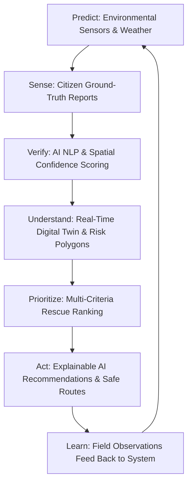

# 🌍 ClimateOS — Product Requirements Document (PRD)

**Version:** 2.1 — Implemented MVP & Operational Specification  
**Status:** Implemented / Active  
**Theme:** AI for Climate Change & Urban Flood Disaster Intelligence  
**License:** GNU GPL v3  
**Repository:** [github.com/rajwadhwani25-afk/ClimateOS](https://github.com/rajwadhwani25-afk/ClimateOS)  

---

## 1. Executive Summary & Vision

**ClimateOS** is an AI-powered disaster intelligence and response platform that bridges the information gap between citizens and emergency authorities during climate disasters. Urban flooding presents rapid, localized hazards where official static flood maps become obsolete within minutes.

Rather than functioning solely as a passive weather monitor or isolated alert app, ClimateOS establishes an **adaptive, closed intelligence loop**:



> **Core Metric / Product North Star:** Minimize the time between *"Something is happening on the ground"* and *"The right person is taking the right action."*

---

## 2. Problem Statement & User Personas

### 2.1 The Information Gap
During sudden urban flooding:
- **Citizens ask:** *Is my immediate street flooded? Where is the nearest open shelter with space? Which route is safe right now? How do I request rescue?*
- **Authorities ask:** *Which citizen reports are genuine? Where are lives in immediate danger? Which roads are passable for emergency vehicles? Where should boats and pumps be dispatched first?*

### 2.2 User Personas & Core Journeys

| Persona | Core Need | Key Platform Features |
|---|---|---|
| **Urban Citizen** | Hyper-local awareness, evacuation guidance, emergency reporting | One-click GPS risk detection, capacity-aware shelter navigation, AI safe routing, photo/voice incident reporting |
| **Emergency Commander** | City-scale situational awareness, decision support, resource dispatch | 2.5D Leaflet Digital Twin, real-time SSE incident feed, AI recommendation review (Approve/Reject), disaster simulation dials |
| **Field Responder** | Operational triage, verified coordinates, safe transit corridors | Urgency-ranked rescue queues (0–100), hazard avoidance maps, verified victim counts |

---

## 3. Product Principles

1. **Human-in-the-Loop Authority:** AI acts strictly as an intelligence and decision-support layer. Final emergency decisions (evacuation orders, deployment authorizations) remain with authorized emergency personnel.
2. **Action Over Raw Data:** Never overwhelm users with raw metrics. Present clear, actionable guidance (e.g., *"Move to high ground"*, *"Dispatch rescue team to Zone A"*).
3. **No False Safety Promises:** Evacuation routes are computed based on best available ground truth, labeled as `SIMULATED_SAFE` with explicit warnings that conditions can change rapidly.
4. **Privacy-Preserving Geolocation:** Citizen coordinates are processed ephemerally in-memory for spatial lookups and safe routing; raw locations are never tracked or sold.

---

## 4. System Architecture & Implemented Engines

ClimateOS is composed of modular backend micro-engines integrated via FastAPI and served to modern, responsive web interfaces:

```
├── services/
│   ├── main.py                  # FastAPI application entry point & CORS
│   ├── risk_engine/             # Ray-casting point-in-polygon & multi-factor risk
│   ├── routing/                 # A* risk-aware safe path calculation
│   ├── verification/            # NLP incident classification & confidence scoring
│   ├── priority_engine/         # Multi-criteria rescue priority ranker (0-100)
│   ├── recommendation/          # Explainable AI (XAI) emergency advisor
│   └── routers/                 # REST & SSE endpoint controllers
│       ├── risk.py              # GET /api/zones/risk
│       ├── routing.py           # POST /api/routes/safe-route
│       ├── reports.py           # POST /api/reports, GET /api/incidents, SSE stream
│       ├── shelters.py          # GET /api/shelters
│       ├── recommendations.py   # GET/POST /api/recommendations
│       └── simulation.py        # POST /api/simulation
```

### 4.1 Risk Engine (`services/risk_engine/engine.py`)
- **Spatial Resolution:** Ray-casting point-in-polygon algorithm over `data/zones.geojson`.
- **Inputs:** Current rainfall (mm/h), river/drainage water levels (m), terrain elevation, active citizen incident density.
- **Outputs:** Numerical Risk Score (0–100), Severity Level (`LOW`, `MODERATE`, `HIGH`, `SEVERE`), Zone Identifier (`Zone A – Riverside`), and actionable citizen instructions.

### 4.2 AI Safe-Route Engine (`services/routing/safe_route.py`)
- **Routing Objective:** Compute evacuation trajectories that actively route around flooded road segments, severe risk zones, and blocked bridges.
- **Inputs:** Citizen origin `[lat, lng]`, destination shelter ID, active hazard buffer polygons.
- **Outputs:** GeoJSON `Feature<LineString>` containing route coordinates, total distance, risk score, list of avoided hazards, and safety status (`SIMULATED_SAFE` / `SIMULATED_CAUTION`).

### 4.3 AI Report Verification Engine (`services/verification/verifier.py`)
- **Validation Pipeline:**
  1. **NLP Keyword Extraction:** Parses description for critical distress terms (*trapped*, *rising water*, *submerged*, *electric wire*).
  2. **Spatial Plausibility:** Validates report coordinates against hydrological flood model zones.
  3. **Duplicate Clustering:** Correlates multiple independent reports from the same radius.
- **Confidence Rating:** `HIGH` (>0.80), `MEDIUM` (0.50–0.80), `LOW` (<0.50).

### 4.4 Incident Priority Ranker (`services/priority_engine/ranker.py`)
- **Triage Formula:**
  $$\text{Priority} = w_1 \cdot \text{Severity} + w_2 \cdot \text{Casualties/Trapped} + w_3 \cdot \text{Vulnerability} + w_4 \cdot \text{Confidence} - \text{TimeDecay}$$
- **Range:** 0 to 100 score, dynamically sorting the government command incident queue.

### 4.5 Explainable AI (XAI) Recommendation Advisor (`services/recommendation/advisor.py`)
- Generates strategic emergency recommendations (e.g., *"Issue Evacuation for Zone A"*, *"Deploy SDRF Team 3 to Riverside"*).
- **Transparency:** Each recommendation includes machine-generated **XAI Factors** (e.g., `"Rainfall exceeds 90mm/h"`, `"Water level +1.8m above warning limit"`, `"14 trapped citizen reports verified"`).
- **Decision Tracking:** Supports `APPROVE` and `REJECT` audit trails.

### 4.6 Real-Time Event Broker (`services/routers/reports.py`)
- Implements **Server-Sent Events (SSE)** at `GET /api/incidents/stream`.
- When a citizen files a report on `citizen-report.html`, the report is classified and broadcast to all connected government dashboards in <100ms without page reloads.

---

## 5. Functional Requirements Matrix

| ID | Requirement | Status | Verification Path |
|---|---|---|---|
| **FR-01** | Calculate localized disaster risk using point-in-polygon GIS | **Implemented** | `GET /api/zones/risk?lat=18.5260&lng=73.8580` |
| **FR-02** | Display real-time risk heatmaps & zones on interactive 2.5D map | **Implemented** | `citizen-map.html`, `government.html` (Leaflet) |
| **FR-03** | Citizen incident reporting with category, photo, & location | **Implemented** | `citizen-report.html` → `POST /api/reports` |
| **FR-04** | AI incident classification & confidence scoring | **Implemented** | `services/verification/verifier.py` |
| **FR-05** | Urgency and casualty-based incident prioritization | **Implemented** | `services/priority_engine/ranker.py` |
| **FR-06** | Browser GPS geolocation with explicit citizen permission | **Implemented** | `js/citizen/home.js` (`#btn-use-location`) |
| **FR-07** | Risk-aware safe evacuation route calculation | **Implemented** | `POST /api/routes/safe-route`, `citizen-route.html` |
| **FR-08** | Nearest shelter discovery with live capacity & status filtering | **Implemented** | `js/citizen/home.js` (`#btn-navigate-closest-shelter`) |
| **FR-09** | AI resource allocation recommendations with XAI factors | **Implemented** | `GET /api/recommendations`, `services/recommendation/` |
| **FR-10** | Government command center with live real-time dashboard | **Implemented** | `government.html`, `js/government/` |
| **FR-11** | Zero-refresh live incident propagation via SSE | **Implemented** | `GET /api/incidents/stream` |
| **FR-12** | Interactive disaster simulation controls (Rainfall / Water Level) | **Implemented** | `POST /api/simulation`, `government.html` |
| **FR-13** | Closed-loop feedback (citizen reports dynamically alter safe routes) | **Implemented** | `services/routers/routing.py` |

---

## 6. API Specifications & Endpoints

| Method | Path | Description | Sample Query / Body |
|---|---|---|---|
| `GET` | `/api/zones/risk` | Get all zones or query specific coordinates | `?lat=18.5260&lng=73.8580` |
| `GET` | `/api/zones/risk/{zone_id}` | Get telemetry and risk metrics for a single zone | `/api/zones/risk/zone-a` |
| `GET` | `/api/shelters` | Retrieve list of shelters with occupancy & status | N/A |
| `POST` | `/api/routes/safe-route` | Generate risk-avoiding evacuation path | `{"origin": [18.526, 73.858], "shelter_id": "shelter-b"}` |
| `POST` | `/api/reports` | Submit citizen incident observation | `{"category": "flood", "severity": 4, "lat": 18.52, "lng": 73.85}` |
| `GET` | `/api/incidents` | Ranked incident queue with confidence scores | N/A |
| `GET` | `/api/incidents/stream` | Server-Sent Events (SSE) live incident channel | Headers: `Accept: text/event-stream` |
| `GET` | `/api/recommendations` | Explainable AI strategic response proposals | N/A |
| `POST` | `/api/recommendations/{id}/decision` | Commander approval or rejection of action | `{"decision": "approved", "commander": "CP-1"}` |
| `POST` | `/api/simulation` | Execute synthetic weather & hazard scenario | `{"rainfall_mm": 120, "water_level_m": 4.5}` |

---

## 7. Non-Functional Requirements & Performance SLAs

- **Latency:**
  - Route calculation: `< 250ms` for multi-waypoint graph evaluation.
  - Spatial point-in-polygon lookup: `< 30ms`.
  - SSE event propagation: `< 100ms` from report ingestion to dashboard render.
- **Client Footprint:**
  - Zero heavy frontend dependencies; built on Vanilla JS, ES Modules, and Leaflet GIS.
  - Fast load time on 3G mobile connections.
- **Reliability & Offline Graceful Degradation:**
  - Frontend includes mock fallback datasets; UI continues to function with last-known safe data if backend connection drops.
- **Security & Privacy:**
  - Citizen GPS coordinates are held ephemerally in-memory and not stored with personally identifiable information.
  - Comprehensive CORS and input validation on all FastAPI routes via Pydantic schemas.

---

## 8. Success Metrics & KPIs

| Category | Metric | Target |
|---|---|---|
| **Response Velocity** | Time from citizen report to command center visibility | `< 1.0 second` |
| **Response Velocity** | Time to recalculate route upon new road blockage | `< 500 ms` |
| **AI Reliability** | Report classification precision & confidence correlation | `> 85%` |
| **Citizen Safety** | Safe route hazard avoidance rate | `100% of reported flood zones avoided` |
| **System Uptime** | API availability during simulated crisis conditions | `99.9%` |

---

## 9. Future Roadmap (Phases 2 & 3)

### Phase 2: Resilience & Multi-Hazard Expansion
- **Progressive Web App (PWA):** Service worker offline caching for offline maps, emergency guides, and SMS/USSD fallback.
- **Multi-Hazard Extensions:** Coastal storm surges, landslides, urban heatwaves, and industrial chemical leaks.
- **Automated Drone Corridors:** Route verification using automated aerial imagery analysis.

### Phase 3: Hardware Integration & Mutual Aid
- **IoT River Gauge Telemetry:** Direct MQTT ingestion from city water level sensors.
- **Regional Mutual Aid Dispatch:** Cross-jurisdiction resource coordination for boats, de-watering pumps, and medical evacuation helicopters.
